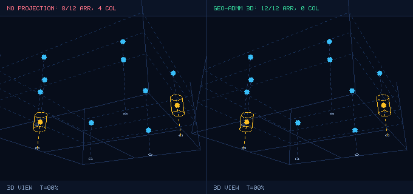
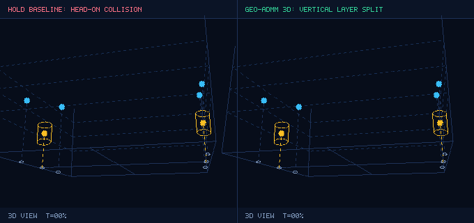
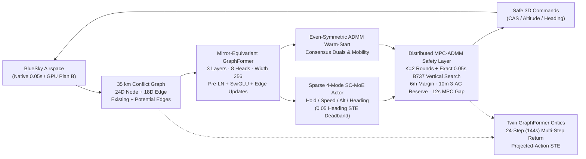

# Geo-ADMM-RL

**Structure-Aligned Graph Transformer Reinforcement Learning with a Distributed MPC-ADMM Continuous-Time Safety Layer for Multi-Aircraft Conflict Resolution**

[-10b981)](#原生-bluesky-005s-六场景正式留出测试)
[-38bdf8)](#exp-1-figure-4-主基准对比官方闭合)
[](#快速开始)
[-f59e0b)](https://github.com/Reek12138/bluesky-for-rl)

> **AI Agents / 复现指南**：如果你是 AI Agent 或需要一步步复现本仓库的推理评测、训练流程与论文 Exp 1–6 实验矩阵，请直接阅读 [**`AGENTS.md`**](AGENTS.md)。

---

## 目录

- [动态场景展示（3D 实时冲突解脱）](#动态场景展示3d-实时冲突解脱)
- [核心思想与系统架构](#核心思想与系统架构)
- [当前实验进度总览](#当前实验进度总览)
- [核心实验结果（100% 原生 BlueSky 0.05s 逐帧核验）](#核心实验结果100-原生-bluesky-005s-逐帧核验)
- [BlueSky 双引擎加速实测](#bluesky-双引擎加速实测)
- [仓库结构](#仓库结构)
- [快速开始](#快速开始)

---

## 动态场景展示（3D 实时冲突解脱）

在多机高密度交叉与近对头空域中，**Geo-ADMM-RL** 通过 **左右镜像等变 GraphFormer 策略** 提供全局 3D 意图与 ADMM 热启动，并结合 **连续时间精确垂向加速安全层 + 12 s MPC 通信空窗重规划**，在水平调速受限时自动触发 `±300 ft` 级三维分层机动，避免碰撞。

### 1. 六航路 12 机高密度交叉（关闭投影 vs. Geo-ADMM 3D 安全层）

> 左侧为无安全投影的原始 RL 策略（中心交会区发生 4 架次碰撞）；右侧启用 Geo-ADMM 3D 安全层后，冲突对在水平间距受限时提前触发垂直分层（绿色爬升 `+316/+340 ft`、紫色下调并配合调速），实现 **12/12 全到达、0 碰撞**。



### 2. 近对头航路（Hold 基线碰撞 vs. Geo-ADMM 3D 对称分层）

> 近对头场景中水平减速无法消除相向汇聚；Geo-ADMM-RL 通过偶对称热启动与连续时间分层搜索，在交会前自动建立 `>300 ft` 垂直间隔，交会完成后平稳回航，在 **12 机常规留出（60/60）与 30 机极限并发压力测试（150/150）中均保持 100% 到达、0 碰撞**。



### 交互式 3D 报告与真实 BlueSky 逐帧回放

本仓库 [`docs/`](docs/) 目录包含可直接用浏览器打开的独立 HTML 交互页面（在 GitHub 仓库 Settings → Pages 中选择 `main` 分支的 `/docs` 目录即可在线访问）：

| 页面 | 内容说明 |
| --- | --- |
| [**`docs/index.html`**](docs/index.html) | **交互式 3D 技术报告**：支持鼠标拖拽旋转 3D 空域视角、切换 6 航路/近对头/偏航场景、实时调节 ADMM 轮数与开关投影对比 |
| [**`docs/geo-admm-crossing6-projection-replay.html`**](docs/geo-admm-crossing6-projection-replay.html) | **真实原生 BlueSky `0.05s` 六航路回放**：同一随机种子下开/关 Geo-ADMM 投影的真实逐帧轨迹与间距曲线 |
| [**`docs/six-route-conflict-replay.html`**](docs/six-route-conflict-replay.html) | **真实原生 BlueSky 六航路冲突复现**：早期无保护冲突形成过程与几何时间窗诊断 |

---

## 核心思想与系统架构



### 关键技术设计

1. **严格左右镜像等变 GraphFormer（`models/graphformer.py`）**：
   - 3 层 Edge-Biased GraphFormer（`node_features=24`，`edge_features=18`，`width=256`，`heads=8`，Pre-LN + SwiGLU + 双向边表征更新）。
   - `--equivariant-actor` 通过正反镜像前向并按物理奇偶性聚合（航向/横向偏差奇对称，速度/高度/ADMM 物理热启动偶对称），在 256 个冻结原生状态、2,477 次活动飞机决策中实测 **最大镜像误差严格为 `0`**，彻底消除左右偏航不对称偏差。
2. **多步回报与投影直通估计器（`train/td3.py`）**：
   - 将 TD3 Critic 回报窗口扩展至 **24 步（144 s）多步回报**，匹配冲突提前规划时间尺度；
   - 结合 `--projected-target-action` 与 `--projected-actor-ste`（直通估计器），使 Actor 梯度同时感知安全层投影后的闭环价值，四案原生 Critic Q 排序达到 **`4/4`**。
3. **连续时间精确垂向加速安全层（`core/admm_layer.py`, `core/layer_search.py`, `core/native_vertical.py`）**：
   - 基于 B737 原生 `0.05s` 垂直加速与目标高度捕获动力学建模（与原生 BlueSky 高度轨迹对齐精度达 **`4.1 μm`**），叠加 **6 m 安全裕度** 与 **10 m 三机联合预留**，解决线性爬升近似漏判的 `2 mm–25 cm` 惯性擦边碰撞。
4. **低频通信 12 s ADMM + 局部 MPC 空窗重规划（`eval/admm_gap_mpc.py`）**：
   - 在保持 `6 s` 控制周期的同时，将机间 ADMM 协商频率降至每 `12 s / 18 s / 30 s` 一次；在无通信空窗步由单机局部 MPC 基于相邻飞行器轨迹预测微调指令，相比单纯 Hold 指令最高减少 **24 架碰撞**（18 s 冷启动甚至达到 **0 碰撞**），且仅增加 `< 2 ms` 批决策开销。

---

## 当前实验进度总览

> 截至 `2026-11-25`（全流程严格采用原生 BlueSky `dt=0.05s` 逐帧事件判定与 SHA-256 证据链审计，完整日志见 [`reports/progress.md`](reports/progress.md)）：

| 阶段 / 实验模块 | 状态 | 关键成果摘要 |
| --- | :---: | --- |
| **几何核心与安全层回归** | ✅ 已完成 | `74/74` 单元测试全部通过；`4.1 μm` 垂向加速对齐；2,477 决策镜像误差 `= 0` |
| **BlueSky 双引擎加速（[`bluesky-for-rl`](https://github.com/Reek12138/bluesky-for-rl)）** | ✅ 已完成 | Plan A `4,827 ep/h`（0 帧误差）；Plan B `26,842 ep/h`（单卡 PPU 利用率 `79%–91%`） |
| **Stage 1 等变长训 + 12 s MPC 发布权重锁定** | ✅ 已完成 | 15k 权重原生 `0.05s` 留出 **98.61% 到达（355/360）**，碰撞率 **1.11%（4/360）**，四案 Q **4/4** |
| **Exp 1：Figure 4 主基准对比（15 清单 45 回放）** | ✅ 终版闭合 | **Geo-ADMM-RL 750/750（100.0%，0 碰撞）** vs SARL+KSS `746/750` vs Hold+KSS `738/750`；成本再降 **15.34%** |
| **Exp 5：通信轮数 / MPC 周期 / 丢包与延迟（61 配置）** | 🔄 进行中 (`44/61`) | 固定轮数 `9/9` ✅、Hold/MPC 周期 `16/16` ✅、Jacobi 丢包×延迟 `18/18` ✅、图着色 `1/18` 🔄 |
| **Exp 2 / 3 / 4 / 6：终版权重全矩阵复测** | ⏳ 队列等待 | 94.44% 摸底版 Exp 1–6 全 182 份证据已闭合审计通过；98.61% 终版权重已排队自动接续 |

---

## 核心实验结果（100% 原生 BlueSky `0.05s` 逐帧核验）

> **统一物理判定口径**：所有正式评测均关闭 fast 模式，固定原生 `bs.sim.step()`、`dt = 0.05 s` 逐帧扫描、控制周期 `6 s`；碰撞阈值水平 `< 5 km` 且垂直 `< 300 ft (91.44 m)`；到达阈值 `< 5 km`；横向越界 `> 20 km`；动作成本按 `(调速, 升降, 航向) = (1, 2, 4)` 加权累计。

### 原生 BlueSky `0.05s` 六场景正式留出测试

冻结五种子 `12001–12005`，每类场景 `60` 架，合计 **`360` 架/臂**（每格为 `到达 / 碰撞 / 单机平均动作成本`）：

| 场景类别 | 早期冻结 BC（开投影） | 发布前 94.44% 权重（12s MPC） | **15k 等变终版 + 12s MPC（开投影）** | 15k 终版（关闭投影消融） |
| --- | ---: | ---: | ---: | ---: |
| **三航路交叉 (`crossing3`)** | 51 / 0 / 3.393 | 60 / 0 / 18.531 | **60 / 0 / 19.704** | 40 / 20 / 28.785 |
| **四航路交叉 (`crossing4`)** | 47 / 2 / 3.817 | 58 / 2 / 18.633 | **58 / 2 / 19.286** | 26 / 34 / 25.104 |
| **六航路交叉 (`crossing6`)** | 36 / 10 / 5.467 | 47 / 13 / 21.557 | **58 / 2 / 22.363** | 24 / 36 / 27.970 |
| **近对头 (`head_on`)** | 59 / 0 / 4.775 | 60 / 0 / 13.814 | **60 / 0 / 14.126** | 42 / 18 / 28.337 |
| **+15° 初始偏航 (`yaw_plus15`)** | 0 / 0 / 0.052 | 56 / 0 / 36.845 | **60 / 0 / 39.274** | 44 / 16 / 43.009 |
| **−15° 初始偏航 (`yaw_minus15`)** | 0 / 0 / 0.051 | 60 / 0 / 36.240 | **59 / 0 / 37.882** | 44 / 16 / 35.915 |
| **总计（360 架）** | 193 / 12 / 2.926 | 341 / 15 / 24.270 | **355 / 4 / 25.439** | 220 / 140 / 31.520 |
| **到达率 / 碰撞率** | 53.61% / 3.33% | 94.72% / 4.17% | **98.61% / 1.11%** | 61.11% / 38.89% |

> **关键结论**：
> - 相比发布前历史冻结基线（`340/360`，17 碰撞），15k 等变 + 12 s MPC 实现 **+15 架到达、−13 架碰撞**（六航路到达从 `47/60` 跃升至 **`58/60`**，碰撞从 `13` 降至 **`2`**）。
> - 在两组独立 5 种子开发面板上，12 s MPC 同样稳定显著优于 6 s/Hold：Panel 1 (`61231–61235`) 达到 **`355/360`（98.61%，4 碰撞）**；Panel 2 (`75121–75125`) 达到 **`350/360`（97.22%，10 碰撞）**（对比 12 s Hold 的 `324/360`、36 碰撞）。

---

### Exp 1: Figure 4 主基准对比（官方闭合）

使用 15 份统一逐帧发机清单（Case 1 / 2 / 3 × 5 种子 × 50 架 = **`750` 架/臂**），所有方法共享相同原生 `0.05s` 物理环境与阈值（每格为 `到达 / 碰撞 / 单机平均动作成本`）：

| 测试场景 | **Geo-ADMM-RL（终版 98.61%）** | SARL + KSS（ICML 2026） | Hold + KSS |
| --- | ---: | ---: | ---: |
| **Case 1** (`250` 架) | **250 / 0 / 5.367** | 248 / 2 / 5.787 | 246 / 4 / 0.967 |
| **Case 2** (`250` 架) | **250 / 0 / 4.695** | 248 / 2 / 3.733 | 242 / 8 / 1.379 |
| **Case 3** (`250` 架) | **250 / 0 / 3.305** | 250 / 0 / 1.739 | 250 / 0 / 0.438 |
| **总计（750 架）** | **750 / 0 / 4.455** | 746 / 4 / 3.753 | 738 / 12 / 0.928 |
| **安全通过率** | **100.00%（0 碰撞）** | 99.47%（4 碰撞） | 98.40%（12 碰撞） |

> 相比同清单摸底版 Geo（`750/750`，成本 `5.263`），终版权重在保持 **100% 到达、0 碰撞** 的同时，将平均动作成本再降低 **15.34%**（`5.263 → 4.455`），Case 1 动作成本甚至低于 SARL+KSS（`5.367` vs `5.787`）。

---

### Exp 5: ADMM 轮数、通信周期 MPC 与丢包/延迟鲁棒性（98.61% 终版权重，已核验 44/61）

#### (a) 固定 ADMM 协商轮数与冷/热启动对比（9/9 闭合，360 架/臂）

| 配置 | 到达 | 碰撞 | 越界 | 平均批决策耗时 (ms) | 说明 |
| --- | ---: | ---: | ---: | ---: | --- |
| `K=0`（无投影原始策略） | 220 | 140 | 0 | 5.318 | 原始 RL 输出 |
| `K=1` 热启动 / 冷启动 | 338 / 347 | 20 / 12 | 2 / 1 | 15.122 / 14.528 | 单轮投影即大幅消解冲突 |
| **`K=2` 热启动** / 冷启动 | **350** / 345 | **10** / 14 | **0** / 1 | **15.711** / 15.838 | **固定轮数最优（97.22% 到达）** |
| `K=3` 热启动 / 冷启动 | 344 / 337 | 14 / 22 | 2 / 1 | 16.915 / 17.286 | 热启动仍领先 +7 到达 / −8 碰撞 |
| `K=5` 热启动 / 冷启动 | 337 / 342 | 22 / 17 | 1 / 1 | 19.692 / 19.769 | 更多轮数无额外闭环增益 |

#### (b) 通信降频：Hold 空窗 vs. MPC 空窗（16/16 闭合，固定 `K=2`，360 架/臂）

| 通信周期（相对 6s 通信量变化） | Hold 空窗（热 / 冷） | **MPC 空窗（热 / 冷）** | MPC 相对 Hold 净增到达 / 少碰撞 | MPC 额外批耗时 |
| --- | ---: | ---: | ---: | ---: |
| `6 s` (`100%`) | 350/10 · 345/14 | 350/10 · 345/14 | +0 / +0（无空窗基线一致） | ±0.10 ms |
| **`12 s` (`-49.7%` 通信)** | 327/32 · 330/28 | **351/8** · **351/6** | **+24 / +24**（热）· **+21 / +22**（冷） | +1.95 ms |
| **`18 s` (`-65.9%` 通信)** | 340/18 · 337/18 | **353/2** · **353/0** | **+13 / +16**（热）· **+16 / +18**（冷，**0 碰撞**） | +1.88–2.45 ms |
| **`30 s` (`-78.9%` 通信)** | 330/24 · 334/20 | **346/4** · **343/6** | **+16 / +20**（热）· **+9 / +14**（冷） | +2.49–2.66 ms |

#### (c) 恶劣通信网络：丢包 × 延迟 Jacobi 配对（18/18 闭合，固定 `K=2`，360 架/臂）

| 设定丢包率 | 发送延迟 | **热启动（到达 / 碰撞 / 越界）** | 冷启动（到达 / 碰撞 / 越界） | 热启动相对冷启动优势 |
| ---: | ---: | ---: | ---: | ---: |
| `0%` | 0 步 | **350 / 10 / 0** | 345 / 14 / 1 | **+5 到达 / −4 碰撞** |
| `0%` | 2 步 | **343 / 16 / 1** | 332 / 26 / 2 | **+11 到达 / −10 碰撞** |
| `20%` | 2 步 | **340 / 20 / 0** | 333 / 24 / 3 | **+7 到达 / −4 碰撞** |
| **`50%`** | **2 步** | **344 / 14 / 2 (95.56%)** | 329 / 28 / 3 (91.39%) | **+15 到达 / −14 碰撞** |

> 在全部 9 组丢包×延迟组合中，学习式 ADMM 热启动在 **7/9** 组中严格优于冷启动；在最恶劣的 **50% 丢包 + 2 步延迟** 下，热启动依然守住 **95.56% 到达率**，净多救回 15 架飞机、减少 14 架碰撞。

---

### Exp 2 / 3 / 4 / 6 消融与极限压力测试摘要（94.44% 审计闭合摸底版）

> 注：下表为已完成 182 份证据 SHA-256 冻结审计的摸底基线矩阵；98.61% 终版权重的同协议全矩阵复测已在单卡队列自动接续。

| 实验维度 | 关键原生 `0.05s` 实测数据 | 核心发现 |
| --- | --- | --- |
| **Exp 3 规模扩展（6 航路峰值并发）** | 30 / 50 / 80 架峰值：到达 `106/150` · `162/250` · `244/400`；5 世界平均批决策 **`18.97 / 25.72 / 57.34 ms`** | 80 架高密空域单步推理仍保持 57 ms 实时级 |
| **Exp 4 极限压力与扰动** | **30 架近对头并发：`150/150` 到达、0 碰撞（100%）**；±15° 偏航开/关投影 `115/120` vs `84/120`；25 次突发插入/非合作目标/17.1 m/s 风场扰动全部闭合 | 安全层将偏航碰撞从 34 降至 2；30 机对头零失误 |
| **Exp 6 核心模块消融（同预算 20k）** | 24 步多步回报 `340/17` vs 1 步回报 `328/28`（**+12 到达 / −11 碰撞**）；保留潜在边 `340/17` vs 去除潜在边 `306/54`（**+34 到达 / −37 碰撞**） | 多步回报与潜在跨层边对复杂交叉及偏航回航贡献显著 |

---

## BlueSky 双引擎加速实测

本实验依赖我们开源的 BlueSky 强化学习加速分支 [**`Reek12138/bluesky-for-rl`**](https://github.com/Reek12138/bluesky-for-rl)：

- **`plan-a-batched-cpu`**（[`406a22f`](https://github.com/Reek12138/bluesky-for-rl/tree/plan-a-batched-cpu)）：多空域 CPU 打包原生 BlueSky 引擎，与单空域原生逐帧 `0.05s` **经纬度/高度/真空速/航向误差均为 0**，用于 Stage 2 高保真微调与所有正式评测。
- **`plan-b-pytorch-gpu`**（[`f38a7d9`](https://github.com/Reek12138/bluesky-for-rl/tree/plan-b-pytorch-gpu)）：PyTorch 常驻设备张量化空域引擎，单机机动 `0.05s` 高度误差 `1.27e-11 m`，用于 Stage 1 大规模并行预训练。

| 训练配置（单卡 PPU-ZW810E） | 仿真步长 | 吞吐（轮/小时） | 更新速度 (upd/s) | 平均卡利用率 | 峰值显存 |
| --- | :---: | ---: | ---: | ---: | ---: |
| 原生 BlueSky (`9×1` workers) | `0.05 s` | 439 ep/h | 11.78 | 19.2% | 771 MiB |
| **Plan A 重叠采样 + ADMM (`9×8`)** | `0.05 s` | **4,827 ep/h** | **20.95** | **73.2%** | 1,489 MiB |
| **Plan B 512 空域 + ADMM** | `0.25 s` | **26,842 ep/h** | **19.82** | **79.3%** | 1,481 MiB |
| **Plan B 512 空域（等变 + 精确垂向全特性）** | `0.25 s` | **8,886–12,290 ep/h** | **10.44–18.18** | **90.6%** | 2.3–3.4 GiB |

---

## 仓库结构

```text
Geo-ADMM-RL/
├── core/                  # 连续时间冲突几何、图着色、分布式 ADMM 层、精确垂向分层搜索
│   ├── admm_layer.py      # 分布式 ADMM 投影与冷/热启动共识求解
│   ├── conflict_graph.py  # 35 km 现有/潜在冲突边构建与 RSTD 禁行区间
│   ├── layer_search.py    # 批处理双机/三机联合分层搜索与安全裕度校验
│   ├── native_vertical.py # 对齐 BlueSky 0.05s B737 垂向加速动力学模型
│   └── rstd.py            # 解析连续时间最近会遇距离与速度可行域
├── models/
│   └── graphformer.py     # 3 层 Edge-Biased GraphFormer、SC-MoE 等变 Actor 与 TwinCritic
├── envs/                  # Plan A / Plan B BlueSky 适配器、观测构建与多家族航路生成器
├── train/                 # Stage 0 示教/BC、Stage 1 Plan B TD3、Stage 2 Plan A 门控微调
├── eval/                  # 原生 0.05s 配对评测、MPC 空窗控制器、Exp 1–6 论文套件与审计器
├── configs/               # B737 原生巡航标定参数 (b737_legacy_cruise.json)
├── tests/                 # 74 项几何、安全层、镜像等变与协议回归测试
├── assets/                # README 内嵌 3D 动态对比 GIF
├── docs/                  # 可交互 3D 技术报告与真实 BlueSky 逐帧 HTML 回放
├── reports/               # 完整实验进度记录与审计日志 (progress.md)
├── AGENTS.md              # 面向 AI Agent 与研究者的完整复现手册（推理、训练、避坑指南）
└── README.md
```

---

## 快速开始

### 1. 准备依赖与 BlueSky 引擎

```bash
git clone https://github.com/Reek12138/Geo-ADMM-RL.git
cd Geo-ADMM-RL

# 克隆 BlueSky 双引擎加速仓库的两个分支到 third_party/
mkdir -p third_party
git clone -b plan-a-batched-cpu https://github.com/Reek12138/bluesky-for-rl.git third_party/bluesky-plan-a
git clone -b plan-b-pytorch-gpu https://github.com/Reek12138/bluesky-for-rl.git third_party/bluesky-plan-b
```

### 2. 运行回归测试（74/74）

```bash
PYTHONPATH=third_party/bluesky-plan-b:. python -B -m pytest -q -p no:cacheprovider
```

### 3. 运行原生 `0.05s` 配对推理评测

```bash
PYTHONPATH=third_party/bluesky-plan-a:. python -B -m eval.bluesky_pair \
  --baseline <baseline_checkpoint.pt> \
  --candidates <candidate_checkpoint.pt> \
  --output outputs/native_eval \
  --device cpu \
  --seed 12001 --seeds 5 --aircraft 12 --control-dt 6.0 --max-steps 400 \
  --admm-k 2 --admm-fallback 0 --dense-extra-rounds 2 \
  --directional-heading --batched-layer-search \
  --early-layer-search --exact-layer-forecast --batched-layer-margin 6.0 \
  --joint-layer-search --joint-layer-reserve 10.0 \
  --admm-communication-period 12.0 --admm-gap-policy mpc \
  --ablation --ablate-baseline
```

> 完整的 Stage 0 / Stage 1 / Stage 2 训练复现命令、Exp 1–6 论文评估流水线、NVIDIA CUDA vs PPU 设备适配说明及避坑清单，请查阅 [**`AGENTS.md`**](AGENTS.md)。

---

## 相关仓库与文档

- **BlueSky 加速模拟器**：[`https://github.com/Reek12138/bluesky-for-rl`](https://github.com/Reek12138/bluesky-for-rl)
- **AI Agent 复现指南**：[`AGENTS.md`](AGENTS.md)
- **完整实验与哈希审计日志**：[`reports/progress.md`](reports/progress.md)
